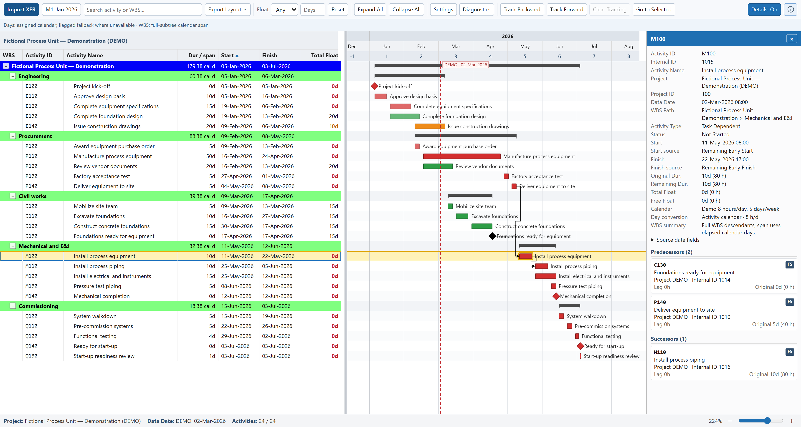

# P6 XER Viewer Gantt Chart

Explore a Primavera P6 XER schedule in your browser: WBS, activity table, relationships, and Gantt chart in one view.

*Select an activity to inspect its dates, duration, float, predecessors, and successors alongside the Gantt chart.*

## Quick start

1. Download [index.html](index.html) using GitHub's **Download raw file** button, or extract the repository ZIP.
2. Open the downloaded HTML in a desktop browser.
3. Click **Import XER** and select your `.xer` file, or drag it into the viewer.

Try [sample.xer](sample.xer) first. It contains 24 fictional activities across engineering, procurement, construction, and commissioning. Its dates and float are illustrative; it is a viewer demonstration, not a validated P6 import template.

## Review and share

- Expand the WBS, search activities or WBS names, and filter by total float.
- Select an activity to inspect dates, duration, float, predecessors, and successors.
- Use **Track Backward / Forward** to add linked activities around your selection.
- Zoom the timeline and resize the table/Gantt divider to reveal more columns.
- **M1 Origin** changes the month-number origin; it is not a baseline comparison.

| Export | What it contains |
|---|---|
| **HTML — Full schedule** | All imported activities, including those hidden by filters or collapsed WBS groups. |
| **HTML — Filtered subset** | Current results, including pinned activities, and relationships between included activities. |
| **Excel — Results + link context** | Schedule tables, normalized data, relationships, and export information. No Gantt graphics. |

Exported HTML includes schedule data and can be reopened without the original XER. Review it before sharing. Excel can also include linked activity identifiers outside your results and diagnostics from the full imported schedule.

## Requirements and limits

Use a modern desktop browser. P6, add-ins, and a server are not required. Parsing and export run locally, without external script or stylesheet dependencies. Browser storage retains display preferences and project-specific M1 origins.

This viewer **does not calculate CPM or reschedule activities**. Dates, float, and path indicators come from the imported data. Hours-to-days conversion uses calendar information or a marked fallback. WBS duration represents a calendar span, not working duration. Check **Diagnostics** and **Settings** for assumptions.

The configured import limit is 128 MiB, or 8 MiB without local Web Worker support; these are not performance guarantees.

## Verification

Tested in Chrome 156 on Windows using the supplied sample: import, WBS controls, search, float filtering, activity details, link tracking, zoom, resizing, invalid-file handling, HTML download/reopening, and Excel download. No application JavaScript errors or HTTP/HTTPS requests occurred in the tested local viewer workflows. Excel ZIP/XML structure and exported values were checked.

Other browsers, large-file capacity, native P6 import, and desktop Excel rendering remain untested.

Created by [Indra Pandu Prasetyo](https://www.linkedin.com/in/indrapandu).

